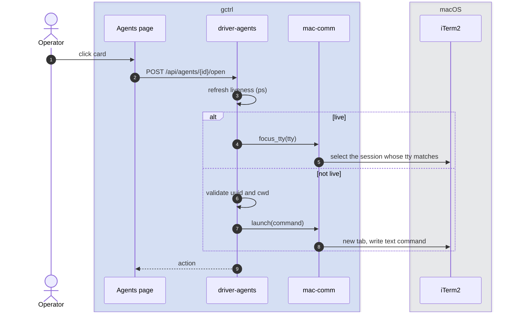

# Agent Panel

> A kanban board of every Claude Code and Codex conversation on the machine. Columns show state, swimlanes group runs by project, and a click focuses the live terminal pane or resumes the conversation in iTerm2. The board rebuilds from the harnesses' own stores, so it survives an app restart and a reboot.

**Status**: in progress. Slices: [ROADMAP § Agent Panel](../../gctrl/ROADMAP.md#agent-panel--in-progress).
**Scope**: kernel driver `gctrl-driver-agents`, mac-comm `launch` and `focus_tty`, the gctrl-board `/agents` page.
**Related**: [adr-session-is-the-spine.md](adr-session-is-the-spine.md), [cc-permission-hook.md](cc-permission-hook.md), [mac-comm.md](../kernel/mac-comm.md).

## Terms

1. **Harness**: the agent CLI that owns a conversation. Values: `claude-code` and `codex`.
2. **Run**: one conversation in one harness, identified by `<harness-prefix>:<native uuid>` (`claude:…`, `codex:…`).
3. **Live**: the harness process for the run exists. For Claude Code, the process start time also matches the registry's `procStart`, or the process is a `claude` CLI. A pid reused after a reboot matches neither.
4. **Headless**: a run with no interactive terminal: Codex `source = exec`, or a Claude transcript whose `entrypoint` is `sdk-cli`.
5. **Stale**: a run that is not live and has no activity for 7 days or more.

## Sources

The driver reads harness stores and never writes them.

| Harness | Store | Fields |
| --- | --- | --- |
| Claude Code | `<config>/projects/<cwd-slug>/<uuid>.jsonl` (top level only; subagent transcripts are excluded) | `cwd`, `gitBranch`, `timestamp`, `entrypoint`, `custom-title.customTitle`, `agent-name.agentName`, `last-prompt.lastPrompt`, `pr-link.{prNumber,prUrl,prRepository}`, `cost-state.totalCostUSD` |
| Claude Code | `<config>/sessions/<pid>.json` (live registry) | `pid`, `sessionId`, `cwd`, `status` (`busy`, `idle`, `shell`), `procStart`, `kind` |
| Codex | `~/.codex/state_<n>.sqlite` → `threads` (highest `<n>` wins) | `id`, `cwd`, `name`, `title`, `first_user_message`, `git_branch`, `git_origin_url`, `tokens_used`, `model`, `archived`, `source`, `thread_source`, `created_at_ms`, `updated_at_ms`, `rollout_path` |
| Codex | Tail of the thread's rollout JSONL | Last `response_item` message with `role = user` |
| Both | `ps -axo pid=,lstart=,tty=,command=` with `LC_ALL=C TZ=UTC`, and `lsof -a -d cwd` | pid liveness, process start time, tty, Codex argv and cwd |

Rules:

1. `<config>` is every Claude Code config dir: `~/.claude`, `~/.claude/clients/*`, `~/.claude-*` and `~/.config/claude/*`. These are the places a per-project `CLAUDE_CONFIG_DIR` (set by direnv) points. Each config dir keeps its own live registry. Their `projects/` dirs are often symlinks to one store, so the driver scans each real path once.
2. The driver never opens `<config>/sessions/*.key`. Those files hold socket credentials.
3. Codex rows with `thread_source` other than `user` (guardian reviews, subagents) are excluded.
4. The driver parses a JSONL transcript incrementally from its last byte offset. A file that shrinks is parsed again from the start.
5. The Codex database opens with `mode=ro`. When Codex is not running, the WAL index is absent and a read-only connection cannot create it. The driver then opens the database with `immutable=1`, which is safe because with no `-wal` file the main database file holds every committed write.
6. A prompt shown on a card excludes harness-injected text: lines that start with `<`, the AGENTS.md preamble, and messages relayed from another agent session.

## Model

The index lives in kernel memory. It is rebuilt from the sources at kernel start and refreshed when `GET /api/agents` is called more than 2 s after the last refresh. Mirroring runs into the `sessions` table is tracked in #240.

| Field | Type | Meaning |
| --- | --- | --- |
| `id` | string | `claude:<uuid>` or `codex:<uuid>` |
| `harness` | `claude-code` \| `codex` | Owning harness |
| `native_id` | string | The harness session or thread uuid |
| `title` | string | Claude custom title, then the Codex thread name or title, then the first prompt (cut to 120 chars) |
| `name` | string \| null | Claude `agent-name` (the `/rename` name), or the Codex thread name |
| `project_key` | string | See § Project key |
| `cwd` | string | Working directory of the run |
| `cwd_exists` | boolean | Whether `cwd` exists now |
| `worktree` | string \| null | The cwd's directory name when the cwd is a linked git worktree |
| `git_branch` | string \| null | Branch at the last record |
| `last_prompt` | string \| null | Last user prompt, cut to 200 chars |
| `pr` | `{number, url, repository}` \| null | Last `pr-link` record (Claude) |
| `cost_usd` | number \| null | Claude `cost-state.totalCostUSD` |
| `tokens` | number \| null | Codex `tokens_used` |
| `model` | string \| null | Codex `model` |
| `started_at`, `updated_at` | RFC 3339 | First and last activity |
| `headless`, `archived`, `stale` | boolean | See § Terms. `archived` is Codex `archived = 1`. |
| `live` | `{pid, tty, status}` \| null | `status` is `busy`, `idle` or `unknown` |
| `state` | `running` \| `idle` \| `resumable` \| `done` | See § States |
| `resume_command` | string \| null | Display copy of the launch command; null when `cwd_exists` is false |

## Project key

1. When the cwd exists, the key is the basename of `git remote get-url origin` without `.git`. Otherwise it is the basename of `git rev-parse --show-toplevel`. Otherwise it is the cwd basename. This is the rule in `shell/hooks/claude-code-inbox.sh`.
2. A Codex thread with `git_origin_url` uses that URL directly.
3. When the cwd is gone, a cwd under `~/wt/<path>/<name>` resolves through `~/workspaces/<path>`. A cwd under `<repo>/.claude/worktrees/<name>` resolves through `<repo>`. Any other cwd resolves through its nearest existing ancestor.
4. The key keeps only `[A-Za-z0-9._-]` and is cut to 64 characters.

## States

| State | Column | Condition |
| --- | --- | --- |
| `running` | Running | Live, and Claude `status = busy` or the Codex rollout file changed in the last 10 s |
| `idle` | Idle | Live, and not running |
| `resumable` | Resumable | Not live |
| `done` | Done | `archived` |

The **Needs you** column is computed by the board. A run is in Needs you when an open inbox message with `requires_action = true` has `context.session_id` equal to the run's `native_id`. The kernel driver makes no assumptions about apps.

## HTTP API

`GET /api/agents?include_headless=false&include_stale=false`

```json
{
  "generated_at": "2026-11-28T09:00:00Z",
  "runs": [ { "id": "claude:26e3…", "harness": "claude-code", "state": "idle", "…": "…" } ],
  "hidden": { "headless": 12, "stale": 340 }
}
```

`POST /api/agents/{id}/open?dry_run=false`

| Case | Status | Body |
| --- | --- | --- |
| Live, and the pane is found by tty in iTerm2 or Terminal.app | 200 | `{"action":"focused","detail":"iTerm2"}` |
| Live, and no pane matches the tty | 200 | `{"action":"none","detail":"terminal_not_found"}` |
| Not live | 200 | `{"action":"launched","command":"cd '…' && claude --resume …"}` |
| `dry_run=true` | 200 | The same body with no AppleScript run, and `action` prefixed `would_` |
| Unknown id | 404 | `unknown run` |
| Not live and `cwd_exists = false` | 409 | `cwd_missing` |
| Automation denied | 403 | From mac-comm |

## Open and resume



1. The launch command is a fixed template: `cd '<cwd>' && claude --resume <uuid>` or `cd '<cwd>' && codex resume -c tui.resume_cwd=current <uuid>`.
2. `<uuid>` matches `^[0-9a-f]{8}-[0-9a-f]{4}-[0-9a-f]{4}-[0-9a-f]{4}-[0-9a-f]{12}$`. `<cwd>` passes the mac-comm `cwd` validator, which excludes `'`, so single quotes are safe.
3. AppleScript receives the command as `item 1 of argv` and never concatenates it into script text.
4. `write text` types into the tab's interactive login shell. User shell functions and aliases for `claude` and `codex` apply, and direnv exports the project's `CLAUDE_CONFIG_DIR` on `cd`, so the harness finds the transcript.
5. Claude keys transcripts by cwd slug and cannot resume from another directory. When `cwd_exists` is false, the board disables Resume.
6. Open re-probes liveness before it acts, and debounces launches of one run for 5 s. A run that is open in any terminal is focused, never launched a second time.

## Board page

1. Route `/agents` in the gctrl-board SPA, with a nav entry. gctrl-desktop renders the page.
2. Columns: Needs you, Running, Idle, Resumable, Done (collapsed). Swimlanes: one per `project_key`, sorted by the most urgent column, then by `updated_at`. A lane with no live run collapses to one summary line.
3. Header toggles: **Show headless** and **Show stale (7d+)**. Both are off by default and map to the query parameters.
4. A card shows `name [worktree]` (or the title), a harness mark, the branch, one line of the last prompt, the relative `updated_at`, cost or tokens, and a PR chip.
5. A click calls `POST /api/agents/{id}/open`, and a toast shows the result. The page polls every 5 s.

## Privacy

1. `/api/agents/*` is served only by the local kernel. The gctrl-board Cloudflare Worker does not proxy it, so prompts and paths stay on the machine.
2. The kernel's host-allowlist middleware limits every route to loopback Host headers.
