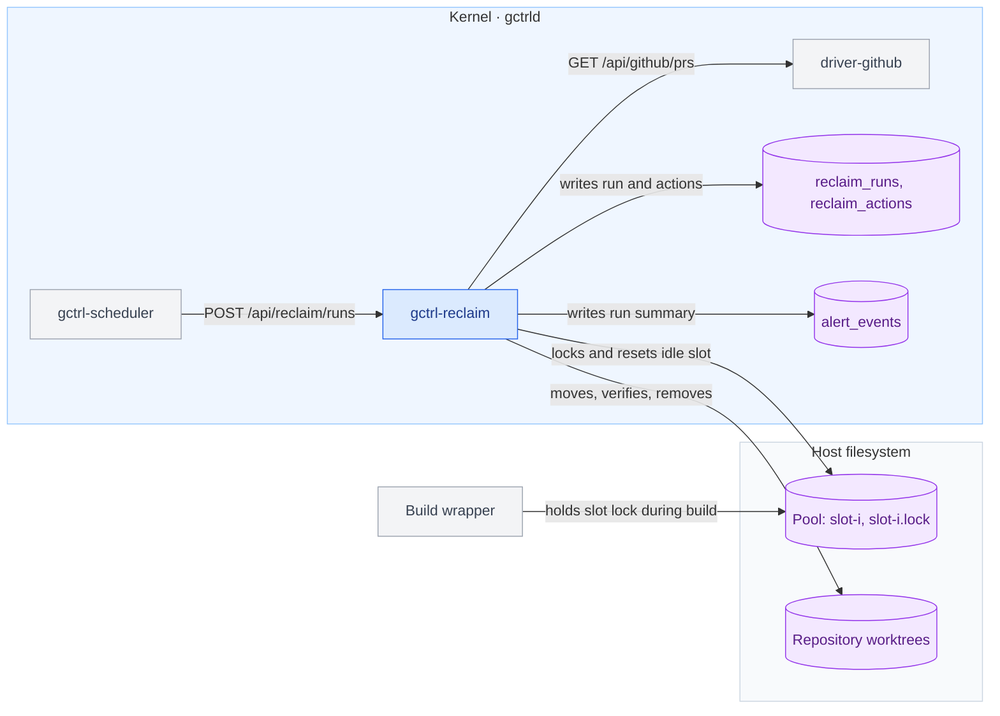

# Reclaim — Build-Pool Retention and Worktree Reaping

Reclaim is a kernel extension that bounds the disk used by two by-products of agent work on one host: pooled Rust target directories and git worktrees whose pull request is merged. The Scheduler fires it on cron; it deletes only data that a build or a dependency install recreates.

Architecture only. Crate wiring and the process-inspection mechanism are specified in `implementation/kernel/reclaim.md` with the implementation. DDL lives in [domain-model.md § 5.1](../domain-model.md#51-kernel-owned-tables-implemented).

## Problem

1. **A shared target directory grows without bound.** Cargo keys the artifacts of a path dependency by the package's absolute path, so each worktree that builds into a shared target directory writes its own copy of every workspace crate and test binary. One measured pool of 3 slots reached 637 GiB in 36 days; a freshly built slot of the same repository is 17 GiB.
2. **Worktrees outlive their branch.** A worktree keeps its dependency install and scratch directories after its pull request merges. One measured repository holds 631 worktrees; dependency installs under worktree paths account for most of the host's used disk.
3. **A full disk stops all agent work.** Builds fail admission, and the Orchestrator keeps dispatching Tasks that cannot build.

## Scope

| In scope | Not specified here |
|----------|--------------------|
| Resetting an idle pool slot that exceeds a size cap | Slot admission, slot locking, and build concurrency: the build wrapper owns them |
| Removing a worktree whose pull request is merged | Removing a worktree with no merged pull request: Reclaim reports it and deletes nothing |
| Run records, telemetry, and alert events | A disk-space condition in Orchestrator dispatch eligibility `[deferred]` — needs a decision on which volume and floor apply per Compute |

Reclaim is a kernel extension under [os.md § Extending the kernel](../os.md#extending-the-kernel): it is agent-agnostic, needs process spawning and filesystem access, and reads or writes no application table. The size cap, grace period, and disposable-path list are operator configuration, not built-in policy.

## Architectural position

The Scheduler triggers Reclaim through the kernel's own HTTP routes; Reclaim reads pull-request state through `driver-github` and never calls GitHub itself.



## Pool contract

Reclaim consumes a pool through its on-disk layout and makes no assumption about the program that fills it.

```text
<pool_root>/<pool>/slot-<i>/        Cargo target directory
<pool_root>/<pool>/slot-<i>.lock    advisory lock file
```

1. A build MUST hold an exclusive `flock` on `slot-<i>.lock` from before its first write to `slot-<i>/` until its Cargo process, and any program `cargo run` starts, exits.
2. A build MUST acquire the lock non-blocking and select another slot when the lock is held.
3. A build MUST tolerate a missing `slot-<i>/` directory by creating it.

## Build-pool retention

### Eviction unit

Reclaim evicts a whole slot. It MUST NOT select files by access time: on APFS with default mount options a second read leaves `st_atime` unchanged, so access time records the first read after a write, not the last use. Cargo's dep-info and fingerprint files store workspace-relative paths, so an artifact cannot be attributed to the worktree that built it.

A slot reset costs one cold build of that slot. At the measured growth of about 6 GiB per slot per day and the default cap, each slot resets about once every 10 days.

Evicting single compilation units by age `[deferred]` — needs a stable Cargo interface for last-use; `-Zmtime-on-use` and Cargo's target-directory garbage collection are unstable in Cargo 1.97.

### Rules

1. A pool run MUST measure, for every pool under each configured `pool_root`, the allocated size of each `slot-<i>/` and the free fraction of the volume holding it.
2. If a configured `pool_root` does not exist or is not a directory, the run MUST record `skipped_missing` for it and continue with the other roots.
3. A slot is a **candidate** when its size exceeds `slot_max_bytes`.
4. While the volume's free fraction is below `volume_min_free`, the largest slot on that volume is also a candidate.
5. A run MUST reset at most one slot per pool, choosing the largest candidate whose lock it acquires, so the pool's other slots stay warm.
6. Before a reset, Reclaim MUST acquire the slot's lock with a non-blocking exclusive `flock`. If the lock is held, Reclaim MUST skip the slot and record `skipped_busy`.
7. While holding the lock, Reclaim MUST rename `slot-<i>/` to `slot-<i>.evict-<run_id>/` in the same directory, then release the lock. It MUST delete the renamed directory after the release, so a build waits for one rename and not for the deletion.
8. Every pool run MUST first delete any `slot-<i>.evict-*/` directory left by an interrupted run.
9. Reclaim MUST NOT follow symbolic links. If `slot-<i>` is a symbolic link, or its resolved path is outside `pool_root`, Reclaim MUST skip it and record `skipped_unsafe`.
10. Reclaim MUST NOT create, delete, or rewrite lock files or any pool entry other than `slot-<i>/` and `slot-<i>.evict-*/`.
11. When a candidate slot is recorded `skipped_busy` in 3 consecutive pool runs, the run MUST write an alert event naming the slot and its size.

## Worktree reaping

### Eligibility

Reclaim enumerates worktrees with `git worktree list --porcelain` in each configured repository. A worktree is **eligible** when all of the following hold:

1. It is a linked worktree. Reclaim MUST NOT remove a repository's main worktree.
2. It has a branch checked out, and `driver-github` reports a merged pull request whose head branch is that branch.
3. The worktree's `HEAD` equals the pull request's head commit, or is an ancestor of it. A worktree with commits the pull request does not contain is not eligible.
4. `git status --porcelain` reports no modified tracked file and no untracked file.
5. Every ignored path, as listed by `git ls-files --others --ignored --exclude-standard --directory`, matches a glob in `disposable_globs`. An ignored path outside that list (an `.env` file, a dataset, a hand-written note) makes the worktree ineligible.
6. The worktree is not locked (`git worktree lock`).
7. The pull request merged at least `merge_grace` ago.
8. No running process has its working directory or an open file inside the worktree.
9. The worktree contains no configured `pool_root`.

`driver-github` MUST expose, for a repository and head branch, each pull request's `state`, `mergedAt`, and head commit SHA. `GET /api/github/prs` lists open pull requests only and returns `number`, `title`, `state`, `author`, `url`, and `branch` (`gh_list_prs` and `normalize_gh_pr` in `gctrl-otel/src/receiver.rs`). The route gains `state` and `branch` query filters and returns `head_sha` and `merged_at`.

### Removal

Removal moves the worktree out of its path before deleting it, so a process that resolves the worktree by path after the move fails to find it instead of writing into a directory being deleted.

1. Reclaim MUST move each eligible worktree with `git worktree move <path> <repo_git_dir>/reclaim-quarantine/<run_id>-<name>`.
2. After the move, Reclaim MUST re-evaluate eligibility conditions 3, 4, 5, and 8 against the quarantined path.
3. If any re-evaluated condition fails, Reclaim MUST move the worktree back to its original path and record `restored`. If the move back fails, Reclaim MUST record `failed` with both paths and leave the worktree in quarantine.
4. If every condition holds, Reclaim MUST run `git worktree remove <quarantined path>` without `--force`.
5. If `git worktree remove` exits non-zero, Reclaim MUST NOT retry it, MUST leave whatever remains at the quarantined path, and MUST record `failed` with that path and the redacted stderr. `git worktree remove` is not transactional; a failure can leave a partially deleted worktree, and the quarantine path keeps it out of the agents' working paths.
6. Every worktree run MUST list any directory in `reclaim-quarantine/` older than the run and record each one as `reported`.

### Branch deletion

1. Where `delete_branch` is true, after a successful removal Reclaim MUST delete the local branch with `git update-ref -d refs/heads/<branch> <head_sha>`, where `<head_sha>` is the pull request's head commit. `update-ref` deletes the ref only if it still points at that commit, so a branch advanced after the eligibility check is kept.
2. Reclaim MUST NOT use `git branch -D`, delete a remote branch, push, or fetch.

### Stale and unreachable

1. A linked worktree with no merged pull request is **stale** when its `HEAD` commit's committer date and the modification time of its index file (`<git_common_dir>/worktrees/<name>/index`) are both older than `stale_after`. Reclaim MUST record it as `reported` and MUST NOT modify it.
2. If `driver-github` is unreachable or returns an error for a repository, Reclaim MUST skip that repository and record `skipped_no_evidence`.
3. A worktree run MUST end with `git worktree prune` in each repository it removed a worktree from.

## Modes and triggers

| Mode | Behaviour |
|------|-----------|
| `report` (default) | Evaluates every rule, records each planned action as `planned`, and changes no file |
| `enforce` | Performs the actions |

1. On startup the Scheduler MUST plant two `http` schedules through its bootstrap path (`gctrl-scheduler/src/bootstrap.rs`): `_internal.reclaim_pool` and `_internal.reclaim_worktrees`, each firing `POST /api/reclaim/runs` at minute 0 of every hour.
2. With no `pool_roots` and no `repos` configured, a run MUST complete with zero actions.
3. At most one Reclaim run of either kind executes at a time. `POST /api/reclaim/runs` while any run is in progress MUST return `409`.
4. A run in `report` mode with one or more `planned` or `reported` actions, and any run with a `failed` or `restored` action, MUST write one `alert_events` row under the rule id `reclaim.summary`, with a null `session_id` and a message carrying the action counts and reclaimable bytes. Applications MAY surface these rows; Reclaim does not depend on any application.

## Configuration

```toml
# ~/.config/gctrl/config.toml
[reclaim]
mode = "report"                 # "report" | "enforce"

[reclaim.pool]
pool_roots = []                 # absolute paths; each holds <pool>/slot-<i>/
slot_max_bytes = 85899345920    # 80 GiB
volume_min_free = 0.25          # fraction of the volume

[reclaim.worktrees]
repos = []                      # absolute paths of main worktrees
merge_grace = "24h"
stale_after = "30d"
delete_branch = true
disposable_globs = ["**/node_modules/", "**/target/", "**/dist/", ".tmp/", "**/.turbo/"]
```

`ReclaimConfig` lives in `gctrl-core/src/config.rs` beside `SchedulerConfig` ([principles.md § Crate Ownership](../../principles.md#crate-ownership) #1).

1. The daemon MUST validate `[reclaim]` at startup. On any violation below it MUST log the violation, leave Reclaim disabled, and report the violation from `GET /api/reclaim/status`; the daemon itself keeps running.
2. `mode` MUST be `report` or `enforce`.
3. Every entry of `pool_roots` and `repos` MUST be an absolute path.
4. `slot_max_bytes` MUST be greater than 0.
5. `volume_min_free` MUST be at least 0 and less than 1.
6. `merge_grace` and `stale_after` MUST parse as durations of at least 0 s.
7. No `pool_root` MAY be inside a path listed in `repos`. A `pool_root` inside a linked worktree is excluded at run time by eligibility condition 9.

## HTTP and shell surface

| Route | Behaviour |
|-------|-----------|
| `POST /api/reclaim/runs` | Body `{ "kind": "pool" \| "worktrees", "mode"?: "report" \| "enforce" }`. Starts a run and returns its record. `mode` defaults to the configured mode. `409` while any run is in progress; `503` while Reclaim is disabled. |
| `GET /api/reclaim/runs` | Lists run records, newest first. |
| `GET /api/reclaim/runs/{id}` | One run with its actions. |
| `GET /api/reclaim/status` | Config validity. Per pool: slot sizes, lock state, volume free fraction. Per repository: worktree counts by `eligible`, `stale`, `ineligible`, `quarantined`. Performs no deletion. |

The shell exposes `gctrl reclaim status`, `gctrl reclaim run <pool|worktrees> [--mode]`, and `gctrl reclaim runs` as thin clients of these routes.

## Records and telemetry

A run record carries `id`, `kind`, `mode`, `started_at`, `finished_at`, `bytes_reclaimed`. An action record carries `run_id`, `target_path`, `action`, `bytes`, and `detail`, where `action` is one of `planned`, `reset`, `removed`, `restored`, `reported`, `skipped_busy`, `skipped_unsafe`, `skipped_missing`, `skipped_no_evidence`, `failed`.

Each run emits a `reclaim.run` span with `kind`, `mode`, `actions`, `bytes_reclaimed`, and `duration_ms`. `detail` passes through the Scheduler's stderr redaction ([scheduler.md § Output Redaction](scheduler.md#output-redaction)).

## Tests

| Test | Layer |
|------|-------|
| A slot above `slot_max_bytes` is reset; a slot below it is untouched | `gctrl-reclaim`, `tempfile::TempDir` |
| A slot whose lock another process holds is recorded `skipped_busy` and left intact | same |
| Three consecutive `skipped_busy` runs for one candidate write one alert event | same |
| Two candidate slots in one pool: one run resets only the larger | same |
| A leftover `slot-<i>.evict-*/` is deleted by the next run | same |
| A symbolic-link slot is recorded `skipped_unsafe`; a missing `pool_root` is recorded `skipped_missing` and other roots are still processed | same |
| A worktree at the merged head commit, with only `disposable_globs` ignored paths, is removed | `gctrl-reclaim`, temporary git repository, stub pull-request source |
| A worktree with an extra commit, an untracked file, an ignored `.env`, or a lock is not removed | same |
| A file created in the quarantined worktree before the re-check restores the worktree to its original path | same |
| A branch advanced after eligibility is kept by `update-ref -d` | same |
| The main worktree is never removed | same |
| `driver-github` error yields `skipped_no_evidence` and no removal | same |
| `report` mode records `planned` and changes no file | same |
| `volume_min_free = 2` or a relative `pool_root` disables Reclaim and is reported by `GET /api/reclaim/status` | config unit test |
| `POST /api/reclaim/runs` returns `409` while a run of either kind is in progress | HTTP, `oneshot` |
