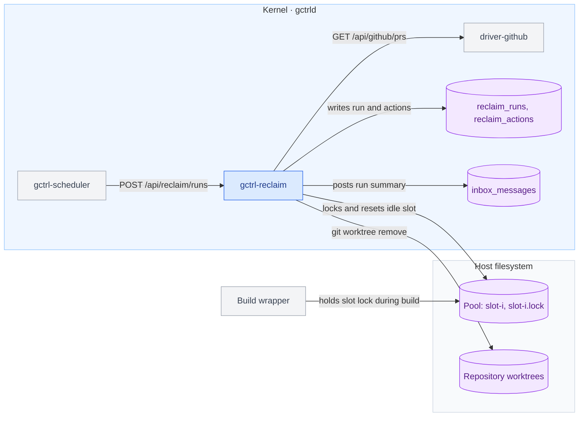

# Reclaim — Build-Pool Retention and Worktree Reaping

Reclaim is a kernel extension that bounds the disk used by two by-products of agent work on one host: pooled Rust target directories and git worktrees whose pull request is merged. The Scheduler fires it on cron; it deletes only what a build or `git worktree add` plus a dependency install recreates.

Architecture only. Crate wiring, the process-inspection mechanism, and DDL are specified in `implementation/kernel/reclaim.md` with the implementation.

## Problem

1. **A shared target directory grows without bound.** Cargo keys the artifacts of a path dependency by the package's absolute path, so each worktree that builds into a shared target directory writes its own copy of every workspace crate and test binary. One measured pool of 3 slots reached 637 GiB in 36 days; a freshly built slot of the same repository is 17 GiB.
2. **Worktrees outlive their branch.** A worktree keeps its dependency install and scratch directories after its pull request merges. One measured repository holds 631 worktrees; dependency installs under worktree paths account for most of the host's used disk.
3. **A full disk stops all agent work.** Builds fail admission, and the Orchestrator keeps dispatching Tasks that cannot build.

## Scope

| In scope | Not specified here |
|----------|--------------------|
| Resetting an idle pool slot that exceeds a size cap | Slot admission, slot locking, and build concurrency: the build wrapper owns them |
| Removing a worktree whose pull request is merged | Removing a worktree with no merged pull request: Reclaim reports it and deletes nothing |
| Run records, telemetry, and an Inbox summary | A disk-space condition in Orchestrator dispatch eligibility `[deferred]` — needs a decision on which volume and floor apply per Compute |

Reclaim is a kernel extension under [os.md § Extending the kernel](../os.md#extending-the-kernel): it is agent-agnostic, needs process spawning and filesystem access, and knows no application. The size cap and grace period are operator configuration, not built-in policy.

## Architectural position

The Scheduler triggers Reclaim through the kernel's own HTTP routes; Reclaim reads pull-request state through `driver-github` and never calls GitHub itself.



## Pool contract

Reclaim consumes a pool through its on-disk layout and makes no assumption about the program that fills it.

```text
<pool_root>/<pool>/slot-<i>/        Cargo target directory
<pool_root>/<pool>/slot-<i>.lock    advisory lock file
```

1. A build MUST hold an exclusive `flock` on `slot-<i>.lock` from before its first write to `slot-<i>/` until its Cargo process, and any program `cargo run` starts, exits.
2. A build MUST acquire the lock non-blocking and select another slot when the lock is held.
3. A build MUST tolerate a missing `slot-<i>/` directory by creating it.

## Build-pool retention

### Eviction unit

Reclaim evicts a whole slot. It MUST NOT select files by access time: on APFS with default mount options a second read leaves `st_atime` unchanged, so access time records the first read after a write, not the last use. Cargo's dep-info and fingerprint files store workspace-relative paths, so an artifact cannot be attributed to the worktree that built it.

A slot reset costs one cold build of that slot. At the measured growth of about 6 GiB per slot per day and the default cap, each slot resets about once every 10 days and a 3-slot pool holds at most 240 GiB.

Evicting single compilation units by age `[deferred]` — needs a stable Cargo interface for last-use; `-Zmtime-on-use` and Cargo's target-directory garbage collection are unstable in Cargo 1.97.

### Rules

1. A pool run MUST measure, for every pool under each configured `pool_root`, the allocated size of each `slot-<i>/` and the free fraction of the volume holding it.
2. A slot is a **candidate** when its size exceeds `slot_max_bytes`.
3. While the volume's free fraction is below `volume_min_free`, the largest slot on that volume is also a candidate.
4. A run MUST reset at most one slot per pool, choosing the largest candidate, so the pool's other slots stay warm.
5. Before a reset, Reclaim MUST acquire the slot's lock with a non-blocking exclusive `flock`. If the lock is held, Reclaim MUST skip the slot and record the action `skipped_busy`.
6. While holding the lock, Reclaim MUST rename `slot-<i>/` to `slot-<i>.evict-<run_id>/` in the same directory, then release the lock. It MUST delete the renamed directory after the release, so a build waits for one rename and not for the deletion.
7. Every pool run MUST first delete any `slot-<i>.evict-*/` directory left by an interrupted run.
8. Reclaim MUST NOT follow symbolic links. If `slot-<i>` is a symbolic link, or its resolved path is outside `pool_root`, Reclaim MUST skip it and record `skipped_unsafe`.
9. Reclaim MUST NOT create, delete, or rewrite lock files or any pool entry other than `slot-<i>/` and `slot-<i>.evict-*/`.

## Worktree reaping

### Eligibility

Reclaim enumerates worktrees with `git worktree list --porcelain` in each configured repository. A worktree is **eligible** when all of the following hold:

1. It is a linked worktree. Reclaim MUST NOT remove a repository's main worktree.
2. It has a branch checked out, and `driver-github` reports a merged pull request whose head branch is that branch.
3. The worktree's `HEAD` equals the pull request's head commit, or is an ancestor of it. A worktree with commits the pull request does not contain is not eligible.
4. `git status --porcelain` reports no modified tracked file and no untracked file. Ignored files do not block eligibility.
5. The worktree is not locked (`git worktree lock`).
6. The pull request merged at least `merge_grace` ago.
7. No running process has its working directory inside the worktree.

`driver-github` MUST expose, for a repository and head branch, each pull request's `state`, `mergedAt`, and head commit SHA. `GET /api/github/prs` returns `number,title,state,author,headRefName,url` for open pull requests only (`gctrl-otel/src/receiver.rs`, `gh_list_prs`); the route gains `state` and `head` filters and the `headRefOid` and `mergedAt` fields.

### Rules

1. For each eligible worktree, Reclaim MUST run `git worktree remove <path>` without `--force`. This deletes the worktree's ignored files, including its dependency installs and scratch directories.
2. If `git worktree remove` exits non-zero, Reclaim MUST leave the worktree unchanged and record `failed` with the redacted stderr.
3. Where `delete_branch` is true, after a successful removal Reclaim MUST delete the local branch with `git branch -D` only when the branch tip equals the pull request's head commit or is an ancestor of it.
4. Reclaim MUST NOT delete a remote branch, push, or fetch.
5. A linked worktree with no merged pull request and no change to its git metadata for `stale_after` is **stale**. Reclaim MUST record it as `reported` and MUST NOT modify it.
6. If `driver-github` is unreachable or returns an error for a repository, Reclaim MUST skip that repository and record `skipped_no_evidence`.
7. A worktree run MUST end with `git worktree prune` in each repository it removed a worktree from.

## Modes and triggers

| Mode | Behaviour |
|------|-----------|
| `report` (default) | Evaluates every rule, records each planned action as `planned`, deletes nothing |
| `enforce` | Performs the actions |

1. On startup the Scheduler MUST plant two `http` schedules through its bootstrap path (`gctrl-scheduler/src/bootstrap.rs`): `_internal.reclaim_pool` and `_internal.reclaim_worktrees`, each firing `POST /api/reclaim/runs` at minute 0 of every hour.
2. With no `pool_roots` and no `repos` configured, a run MUST complete with zero actions.
3. At most one run per kind executes at a time. A second `POST /api/reclaim/runs` for a kind with a run in progress MUST return `409`.
4. A run in `report` mode with one or more `planned` or `reported` actions, and any run with a `failed` action, MUST post one Inbox message carrying the action counts and reclaimable bytes.

## Configuration

```toml
# ~/.config/gctrl/config.toml
[reclaim]
mode = "report"                 # "report" | "enforce"

[reclaim.pool]
pool_roots = []                 # absolute paths; each holds <pool>/slot-<i>/
slot_max_bytes = 85899345920    # 80 GiB
volume_min_free = 0.25          # fraction of the volume

[reclaim.worktrees]
repos = []                      # absolute paths of main worktrees
merge_grace = "24h"
stale_after = "30d"
delete_branch = true
```

`ReclaimConfig` lives in `gctrl-core/src/config.rs` beside `SchedulerConfig` ([principles.md § Crate Ownership](../../principles.md#crate-ownership) #1).

## HTTP and shell surface

| Route | Behaviour |
|-------|-----------|
| `POST /api/reclaim/runs` | Body `{ "kind": "pool" \| "worktrees", "mode"?: "report" \| "enforce" }`. Starts a run and returns its record. `mode` defaults to the configured mode. |
| `GET /api/reclaim/runs` | Lists run records, newest first. |
| `GET /api/reclaim/runs/{id}` | One run with its actions. |
| `GET /api/reclaim/status` | Per pool: slot sizes, lock state, volume free fraction. Per repository: worktree counts by `eligible`, `stale`, `ineligible`. Performs no deletion. |

The shell exposes `gctrl reclaim status`, `gctrl reclaim run <pool|worktrees> [--mode]`, and `gctrl reclaim runs` as thin clients of these routes.

## Records and telemetry

A run record carries `id`, `kind`, `mode`, `started_at`, `finished_at`, `bytes_reclaimed`. An action record carries `run_id`, `target_path`, `action`, `bytes`, and `detail`, where `action` is one of `planned`, `reset`, `removed`, `reported`, `skipped_busy`, `skipped_unsafe`, `skipped_no_evidence`, `failed`.

Each run emits a `reclaim.run` span with `kind`, `mode`, `actions`, `bytes_reclaimed`, and `duration_ms`. `detail` passes through the Scheduler's stderr redaction ([scheduler.md § Output Redaction](scheduler.md#output-redaction)).

## Tests

| Test | Layer |
|------|-------|
| A slot above `slot_max_bytes` is reset; a slot below it is untouched | `gctrl-reclaim`, `tempfile::TempDir` |
| A slot whose lock another process holds is recorded `skipped_busy` and left intact | same |
| Two candidate slots in one pool: one run resets only the larger | same |
| A leftover `slot-<i>.evict-*/` is deleted by the next run | same |
| A symbolic-link slot is recorded `skipped_unsafe` | same |
| A worktree at the merged head commit is removed; one with an extra commit, an untracked file, or a lock is not | `gctrl-reclaim`, temporary git repository, stub pull-request source |
| The main worktree is never removed | same |
| `driver-github` error yields `skipped_no_evidence` and no removal | same |
| `report` mode records `planned` and changes no file | same |
| `POST /api/reclaim/runs` returns `409` while a run of that kind is in progress | HTTP, `oneshot` |
